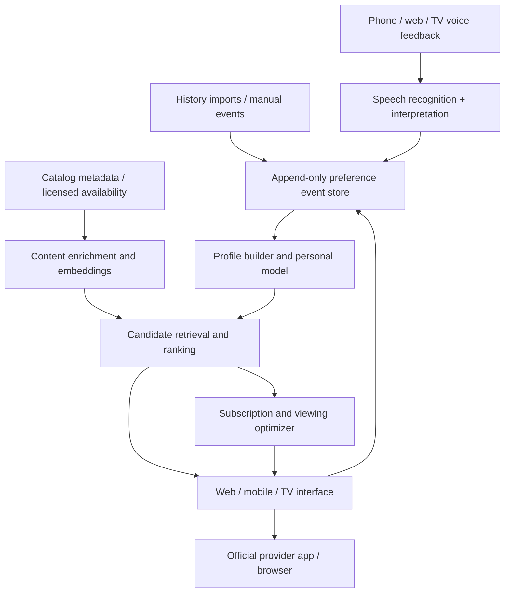

# Personal Entertainment Intelligence
## Project dossier · v0.1 · 24 November 2026

**Status:** discovery / architecture proposal  
**Working title:** Personal Entertainment Intelligence (not a branding decision)  
**Purpose:** a starting brief for maintainers, collaborators and coding agents.  
**Decision:** investigate upstream integration before committing to a permanent application fork.

---

## 1. Executive brief

Build a local-first entertainment system that learns what a household enjoys, discovers relevant films and television across streaming services, and recommends when to activate or pause subscriptions. A unified web/mobile/TV interface launches content in the legitimate provider's app instead of distributing or playing protected streams itself.

The differentiated asset is a portable, continually improving taste profile. Users can express nuanced reactions aloud, in natural language, while browsing or watching. The system preserves the underlying evidence, learns conditional preferences, predicts enjoyment independently of provider availability, and turns those predictions into a feasible viewing and subscription plan.

**Recommended approach:** develop an independent, reusable taste engine with open interfaces; validate against existing projects before building a new frontend. Contribute extension points, provider adapters, bug fixes and tests upstream. Prefer upstream releases over permanent forks.

### Guiding principles

- User ownership: exportable history, feedback, inferred preferences and settings; no provider lock-in.
- Local-first, not local-only: local storage and inference by default; explicit opt-in to cloud model services.
- Taste before availability: discover titles across the entire catalog, including unavailable or future content.
- Voice is a primary input, not merely dictation for a rating form.
- Separate predicted enjoyment, intention to watch, urgency and subscription value.
- Use legitimate provider playback and documented interfaces; avoid DRM bypass and password collection.
- Reuse upstream software where sensible; build only the missing capabilities.
- Validate improvement against simple baselines rather than assuming AI adds value.

## 2. Product scope and experience

### Core journeys

| Journey | Intended experience |
|---|---|
| Discover | Browse a unified catalog ranked by taste, not by the currently paid services. Filter to available now when desired. |
| Watch | Select a title or episode, choose an entitled provider, and launch its official application or browser page. |
| React | Press a microphone button, speak naturally, and return to watching; optionally review or undo what the system inferred. |
| Plan | Review a monthly rotation proposal, including accumulated desirable content, season readiness, upcoming releases, and costs. |
| Watch together | Select household members; surface recommendations that accommodate individual and shared preferences. |
| Correct | Inspect why a title was recommended, edit or reject an inference, and retain control over the underlying profile. |

### Illustrative interaction

A viewer says: “I liked the political world-building, but I hated how the characters made obviously bad decisions just to create drama.” The assistant records the reaction against the relevant episode, identifies the positive and negative attributes, and proposes tentative preference hypotheses. It does not automatically infer that the viewer dislikes political science fiction or all flawed characters.

Later, the viewer asks: “Find something intelligent but not depressing that we can watch together tonight.” The system combines household profiles with temporary mood constraints, returns currently playable titles, and explains why they fit. The temporary request does not rewrite long-term preferences.

### Release boundaries

MVP: one household, separate viewer identities, US availability, movies and series, manual subscription state, web and phone push-to-talk, recommendation feed, basic rotation plan, browser launch links. Android/Google TV and Fire TV are target platforms; native TV delivery follows a handoff feasibility spike.

Non-goals: streaming server, DRM circumvention, automatic purchases or cancellations, always-on microphone, perfect episode-level synchronization, universal provider authentication, training a foundation model, or a commercial multi-tenant service at launch.

## 3. Existing ecosystem and reuse strategy

The shortlist below is based on public documentation, not hands-on testing or a complete code audit. Repository activity, license terms, API stability and maintainer interest must be verified at a pinned commit before adopting code. A repository being visible does not imply permission to reuse it.

| Candidate | Documented overlap | First experiment | Upstream proposal |
|---|---|---|---|
| [Streamline][1] | Self-hosted AI discovery from multiple viewing-history imports; local or cloud inference | Import household sample history and compare recommendations | Portable evidence events and external taste-provider interface |
| [Sofa][2] | Self-hosted film/TV tracking, import and media integration | Test history import, profiles and mobile/web workflow | Optional external ranking provider and feedback action |
| [PenguWatch][3] | Subscription optimizer and planner, episode tracking and SIMKL synchronization | Run a small multi-provider backlog through the planner | Accept predicted enjoyment, uncertainty and viewing-time estimates from external service |
| [MultiStream][4] | Native Android/TV browsing, title handoff, local watch tracking | Test official app links for US services on actual target devices | External recommendation feed and provider adapter tests |
| [MediaShelf][5] | Self-hosted streaming index and routing | Inspect availability data, routing and supported service adapters | Stable provider-resolution API, if maintainers want it |
| [Findarr][6] | Self-hosted film and TV discovery and rated-content filtering | Compare recommendation quality against simpler baselines | Optional external ranker or portable feedback export |
| [Recommenders][7] / [RecAI][8] | Recommendation research and evaluation | Reuse evaluation patterns and algorithms | General-purpose fixes or reproducible benchmark contributions |

### Decision gate: fork or integrate?

Start with Streamline and Sofa, then PenguWatch and MultiStream. Record exact commit, license, deployment commands, test outcomes, import/export formats, extension points, data dependencies, security assumptions and provider coverage. Contact maintainers through public discussions before proposing broad changes. Do not imply that collaboration is agreed.

Choose an existing shell if it can host the end-to-end workflow without invasive changes. Otherwise build a thin new shell consuming independently versioned APIs. Maintain an application fork only if essential functionality cannot be upstreamed or provided by extension. Avoid copying code until licenses and notices are reviewed; service separation alone is not a guarantee of license compliance. Prefer MIT or Apache-2.0 for original code, subject to a dependency and contributor policy review.

Commercial baselines: JustWatch, Reelgood and Plex Discover for discovery and launch usability; StreamWolf and other rotation planners for cost-focused workflows. Use them as comparison products, not as unlicensed data sources.

## 4. Proposed system architecture



### Component boundaries

| Component | Responsibility | Initial implementation |
|---|---|---|
| Catalog | Canonical titles, seasons, episodes, release dates, external IDs, metadata provenance | TMDB adapter; local cache with expiry |
| Availability | Region, provider, offer tier, price, availability window, platform launch target | Authorized provider-data adapter; start with one source |
| Event store | Immutable viewing and feedback evidence, corrections, import deduplication | SQLite, migrations, JSON export |
| Taste engine | Content vectors, user weights, preference hypotheses, rankings and explanations | Python, NumPy/scikit-learn, sentence embeddings |
| Inference gateway | Speech transcription, structured LLM extraction, enrichment | Local inference endpoint; interchangeable model adapters |
| Optimizer | Feasible viewing schedule and subscriptions, cost/utility tradeoffs | Enumerated schedules or OR-Tools once needed |
| Client | Discovery, microphone feedback, profile review, planning, handoff | Existing frontend integration or lightweight responsive web app |

Deploy as a small Docker Compose stack; use a single service and database initially, with clear module boundaries rather than premature microservices. Run local inference through the household's existing AI infrastructure where practical. Keep CPU-only ranking usable even when GPU inference is offline. Use background jobs for catalog enrichment with resource limits and retries. Consider PostgreSQL only when concurrency or multi-household deployment warrants it.

## 5. Taste representation and training plan

### 5.1 Content genome

Represent each title with (1) interpretable attribute scores, (2) a semantic embedding, and (3) collaborative latent features when available. Use a controlled attribute vocabulary inspired by the [MovieLens Tag Genome][9]; begin with about 50–100 useful attributes and expand after evaluation. Candidate dimensions include pacing, narrative complexity, humor, tone, character agency, social commentary, realism, violence, romance, world-building and frustration factors such as contrived conflict.

A content attribute describes the work, not whether a viewer likes it. Each attribute stores score, uncertainty, source, scope (title/season/episode), schema version and enrichment-model version. Unknown is different from zero. Use licensed metadata, summaries and permitted reviews; do not fabricate attributes when evidence is weak. Keep spoilers out of the user-facing description by default. Recompute enriched profiles when the schema or model changes, not on every query.

### 5.2 Personal profile

Maintain a small regularized statistical model, several semantic taste prototypes, and explicit natural-language hypotheses. Examples: “Enjoys political intrigue with credible institutions” or “Slow pacing is acceptable when the narrative rewards attention.” Each hypothesis has evidence references, scope, confidence, contradictions and a user-confirmed flag. Distinguish enduring taste from temporary fatigue or mood. No inferred preference is irrevocable.

A practical initial ranker is regularized logistic or ordinal regression using content attributes, similarity to liked/disliked prototypes, title quality priors and context. Calibrate probabilities against observed outcomes; until sufficient evidence exists, label scores as estimates rather than calibrated probabilities. Train with explicit reactions and pairwise preferences; treat completion and repeat viewing as weaker signals. Never treat an unseen or unexposed item as a negative rating.

### 5.3 Training progression

| Stage | Method | Evidence required |
|---|---|---|
| Baseline A | Popularity and genre matching | Public metadata and ratings |
| Baseline B | Similarity to liked titles minus disliked titles | Imported personal ratings and embeddings |
| Personal v1 | Regularized ordinal/logistic model with interpretable features | Explicit reactions, pairwise comparisons, viewing context |
| Hybrid v2 | Add collaborative signals (LightFM or comparable factorization) | Public interaction data with permission; ID mappings |
| Conversational v3 | Extract and test conditional hypotheses; rerank selected candidates | Evidence-linked language feedback |
| Adaptive v4 | Active learning and limited exploration | Logged exposures, outcomes and opt-out controls |

Use [MovieLens 32M][10] for offline movie experiments and Tag Genome for attribute research. MovieLens is not representative of contemporary TV or a specific household; verify dataset restrictions before training for redistribution or commercial use. TV-specific evaluation must use a separately sourced or voluntarily collected dataset. [LightFM][11], [Sentence Transformers][12] and Recommenders are candidate libraries, not mandated dependencies. Start without LLM fine-tuning; model upgrades should not require losing preference history.

### 5.4 Retrieval and ranking

Retrieve candidates via embedding similarity to multiple taste prototypes, attribute match, collaborative affinity and a small novelty pool. Merge and deduplicate candidates; rank them with the personal model. Optionally use an LLM or cross-encoder to rerank a limited shortlist against explicit hypotheses. Keep explanations grounded in stored evidence; do not invent a reason to justify a score.

Output separate enjoyment, interest/intent, uncertainty and urgency signals. Rank discovery without availability restrictions, then offer an available-now view. For a group, use a weighted combination of individual utility plus a penalty for strong aversions; let users adjust fairness versus average enjoyment. Do not merge profiles permanently just because people watch together.

### 5.5 Evaluation

Use temporal splits (train on earlier events, test later), and group by user/title or series where necessary to avoid leakage. Test cold-start titles separately. Track NDCG@10, Recall@20, explicit satisfaction, calibration error/Brier score for probabilistic outcomes, and coverage/diversity. Compare with popularity and content-only baselines; report uncertainty and sample counts. Voice-specific metrics: extraction precision, mistaken generalization, correction rate, response latency and feedback completion rate. Household metrics: individual satisfaction and worst-member satisfaction. Subscription metrics: realized spending, viewed utility, missed desired content and plan churn.

Initial acceptance gate: a reproducible benchmark, a blinded or randomized comparison of recommendation lists where practical, no evidence leakage, and no regression in user correction or privacy behavior. Define numerical targets after collecting a baseline rather than pretending early small-sample scores are reliable.

## 6. Voice feedback and memory

### Input approach

Prioritize a phone PWA/native companion with a prominent push-to-talk button, plus web microphone capture. Pair to the TV session using a short-lived code or authenticated device token. Later investigate Bluetooth microphones, smart glasses and existing TV remotes. Stock remote microphone buttons may be reserved for system assistants; microphone permission, foreground rules, Bluetooth profiles, and Fire TV compatibility require testing on hardware. Do not assume access to another streaming application's playback state.

When playback is handed off, retain a last-selected title and timestamp. Treat it as a hint, not proof of what the viewer is watching. If context is stale or ambiguous, ask “Are you talking about X?” or offer a one-tap title correction. Allow explicit viewer switching; never silently assign a spouse's opinion to another profile. Shared feedback can be recorded as a separate event with confirmed participants.

### Processing pipeline

1. Capture short audio after explicit activation, with clear recording indicator and cancel control.
2. Transcribe locally (Whisper/faster-whisper or equivalent), preserving original language when supported.
3. Resolve title, viewer and context; request clarification only if material uncertainty remains.
4. Extract structured opinions using a schema-constrained LLM. Distinguish title-specific judgments, general preferences, temporary requests and action commands.
5. Append source transcript and observations. Propose hypothesis updates with confidence, not arbitrary fixed weight increments.
6. Acknowledge briefly; allow edit, undo or deletion. Rebuild affected derived features after correction.
7. Queue expensive ranking updates; immediate feedback capture should not depend on completing catalog reranking.

Example normalized record (illustrative):

```json
{
  "schema_version": 1,
  "event_type": "reaction",
  "event_id": "example-uuid",
  "viewer_id": "viewer-a",
  "title_id": "tmdb:tv:example",
  "context": {"season": 1, "episode": 4, "source": "phone", "title_confirmed": true},
  "transcript": "I love the politics, but the conflict feels contrived.",
  "observations": [
    {"attribute": "political_intrigue", "polarity": "positive", "scope": "title"},
    {"attribute": "contrived_conflict", "polarity": "negative", "scope": "title"}
  ],
  "inference_status": "tentative",
  "model_version": "example-model"
}
```

Storage: discard raw audio after successful transcription by default; retain transcript locally until user deletion. Keep immutable events during normal operation but support genuine deletion of sensitive evidence and derived features, including backup retention policy. Separate raw statements from model interpretations. Log model/version and correction lineage; provide audit and export. Never upload audio or transcripts to a cloud endpoint without clear consent.

## 7. Subscription and viewing optimization

The subscription planner consumes taste predictions but must not simply add every desirable title's runtime. A household has a limited viewing budget, availability windows, overlapping catalogs and existing commitments.

Define a planning horizon (initially three months), weekly viewing capacity, eligible titles/episodes, provider price/tier, billing start and renewal rules, permanent subscriptions, bundles, free/rental alternatives, release cadence and known expiration dates. Unknown expiration is uncertainty, not guaranteed permanence. Model seasons as ordered episodes with a configurable preference for complete-season availability.

Objective: maximize expected utility of actually scheduled viewing minus a user-configurable cost penalty and switching friction, or maximize utility under a strict spend ceiling. Use a diminishing-returns utility for mediocre content and count each title only once across overlapping providers. Distinguish discovery scores from actual intention; offer explicit watchlist overrides. Allow uncertainty-aware scenarios instead of presenting savings as guaranteed.

Illustrative example: provider A has 40 hours of promising content but only 12 realistically fit in a month; provider B has an exceptional eight-hour season. If B yields greater expected enjoyment per feasible viewing hour, the plan can favor B. Delay A until its next season is complete unless expiration or user preference changes the result.

MVP: enumerate monthly service combinations with a simple constrained greedy schedule; test against hand-calculated fixtures. Later move to integer programming if bundles, renewal dates and episode dependencies justify it. Present active/next/wait recommendations, estimated cost, top reasons, expected viewing hours and tradeoffs. Never autonomously subscribe or cancel; users approve and execute changes themselves.

## 8. Interfaces and data contracts

All public contracts versioned under `/v1`; OpenAPI generated from implementation, stable external IDs, region-aware availability, idempotency keys for imports, pagination, explicit unknown values, timestamp and provenance fields. Household-scoped authentication and authorization apply to every endpoint. Provider tokens are not included in profile exports.

| Endpoint (proposed) | Purpose |
|---|---|
| POST /v1/events | Import viewing history or explicit activity |
| POST /v1/feedback | Submit text or transcript with contextual IDs |
| POST /v1/feedback/{id}/corrections | Amend/retract an interpretation |
| GET /v1/profiles/{id} | Read preferences, hypotheses and supporting evidence |
| GET /v1/profiles/{id}/export | Portable versioned JSON export |
| DELETE /v1/profiles/{id} | Delete profile and applicable derived records |
| POST /v1/recommendations | Rank unseen titles for viewer/group and context |
| POST /v1/scores | Batch enjoyment/intent/uncertainty scores by title ID |
| POST /v1/plans | Compute viewing and subscription scenarios |
| GET /v1/titles/{id}/offers | Resolve available providers, tiers and launch URLs |

Core records: Household, Viewer, Title, Season, Episode, Offer, Subscription, ViewingEvent, FeedbackEvent, Observation, PreferenceHypothesis, ContentGenome, ModelSnapshot, RecommendationExposure, Plan and PlanItem. Preserve relationships, source identifiers, data version and validity times. Expose only the minimum information necessary to integrated clients.

## 9. Catalog, handoff and security risks

| Risk | Mitigation / early test |
|---|---|
| Availability data inaccurate or expensive | Compare TMDB watch-provider data and Watchmode terms, geographic coverage, pricing and attribution; cache according to contract. |
| Deep links break or resolve only to app home | Device/provider compatibility matrix, prefer title links, graceful search or web fallback; never promise episode-level support without testing. |
| Provider login or private API fragility | Prefer public documented links, user exports and authorized APIs; avoid storing service passwords; review upstream adapter practices. |
| Feedback attributed to wrong viewer or title | Explicit profile selection, session hints and reversible confirmation. |
| Incorrect content enrichment or spoilers | Evidence/provenance, unknown fields, versioned enrichment and spoiler-safe summaries. |
| Taste model overfits or reinforces narrow tastes | Regularization, uncertainty, diversity, opt-in exploration and baseline evaluation. |
| Data licensing conflicts | Review code licenses, model licenses and metadata/data terms separately, before redistribution. |
| Sensitive viewing history and audio | Local default, TLS for remote access, least privilege, secret storage, deletion and encrypted backups. |
| Too many upstream dependencies | Pin versions; contract tests; stable adapters; replaceable modules. |

Provider handoff spike: test Netflix, Prime Video, Apple TV, Max, Hulu and Disney+ (plus others relevant to the household) on web, Google TV and Fire TV. For each, record whether the app is installed, whether a title/episode link resolves, fallback behavior, return-to-discovery behavior, region, entitlement uncertainty, and last tested date. Test on physical devices; browser success does not imply TV success. Record limitations honestly.

## 10. Development roadmap and agent-ready backlog

| Milestone | Deliverable | Exit criteria |
|---|---|---|
| M0: discovery | Repository audit, licensed data spike, device handoff matrix | Choose shell or thin new app; document actual tests and license decisions |
| M1: evidence | Importers, canonical IDs, portable event store, profile separation | Repeat imports are idempotent; export/restore round-trip; deletion tested |
| M2: taste baseline | Genome, embeddings, ranking, feedback web/phone UI | Reproducible benchmark; explainable recommendation list; corrections rebuild profile |
| M3: voice | Push-to-talk, transcription, evidence extraction and undo | End-to-end on real phone; no always-on capture; uncertain context handled |
| M4: rotation | Availability adapter, manual subscriptions, planner | Valid schedules under capacity/budget, no duplicate content, transparent assumptions |
| M5: living room | Existing TV integration or native client, QR pairing | Successful handoff and fallback on chosen devices; real feedback session tested |
| M6: ecosystem | Documented SDK/API, upstream PRs, packaging | Clean install/upgrade/backup; accepted integrations or maintained adapter alternatives |

Voice and the event store should be built in the first usable release, not postponed until the recommendation engine is sophisticated. Milestones are dependency order, not delivery dates.

### Initial issues

- DISC-01: deploy Streamline, Sofa, PenguWatch and Findarr; pin revisions, document import and UI results.
- DISC-02: review LICENSE, contribution guidelines, dependency obligations and source/data licenses; record SPDX identifiers.
- DISC-03: build launch-link compatibility matrix on actual Google TV/Fire TV/web hardware; test fallback.
- DISC-04: compare availability vendors and terms; estimate catalog and refresh costs; select authorized source.
- DISC-05: open maintainer discussions proposing optional external recommendation/score interfaces; record responses.
- CORE-01: create versioned feedback and viewing schemas, migrations, idempotent importer and export fixtures.
- CORE-02: implement viewer isolation, correction/deletion lineage and backup/restore tests.
- ML-01: construct small labeled validation set, popularity and embedding baseline; publish reproducible metrics.
- ML-02: implement evidence-linked attribute enrichment and regularized personal ranker; test negative and conditional preferences.
- UX-01: build phone/web push-to-talk, context pairing, transcript review and undo.
- ML-03: implement structured speech-reaction extraction; test against hand-labeled ambiguous/conditional reactions.
- PLAN-01: create constrained planner and fixtures covering overlapping providers, bundles, expiring titles and binge readiness.
- INT-01: implement a single upstream-compatible client adapter before adding more frontends.
- OPS-01: Docker Compose, CI, model configuration, secrets, migrations, health checks and backup instructions.

Parallelize discovery, schema design and baseline experiments; defer major frontend work until the shell decision. For agent-driven development, require small PRs, issue-linked acceptance tests, dependency/license checks, reproducible fixtures, and explicit human review for data/privacy changes.

## 11. Decision log and open questions

| Decision | Status |
|---|---|
| Local-first portable taste engine, provider-independent playback | Proposed direction, aligned with discussion |
| New independent repo; upstream-first interfaces | Recommended, conditional on M0 findings |
| Original project license | Provisional MIT/Apache-2.0; not finalized |
| Phone/web push-to-talk first, TV mic later | Proposed sequencing |
| SQLite and Python initial backend | Proposed default, not mandatory |
| No automatic billing actions, no DRM playback | MVP boundary |

Questions to resolve: Which viewing-history exports are available and how complete are they? What API/data budget is acceptable? Is initial preference capture English-only or multilingual (e.g., Mandarin)? How should the household balance shared viewing versus separate viewing? Which providers are permanent because of live sports, bundles or other benefits? How much viewing capacity and how many simultaneous subscriptions should be assumed? Which upstream maintainers are receptive? What is the minimum viable TV handoff coverage? Which title attributes actually improve prediction over simple similarity?

## 12. Reference register

Public project documentation and research entry points, checked or carried forward from the discovery discussion on 24 November 2026. These are leads, not a full license, security or implementation audit. No applications were installed or tested for this dossier.

[1]: https://github.com/abhichandra21/streamline
[2]: https://github.com/jakejarvis/sofa
[3]: https://github.com/pengupowered/penguwatch
[4]: https://github.com/renaudallard/multistream
[5]: https://github.com/ghltshubh/mediashelf
[6]: https://github.com/Lillifee/findarr
[7]: https://github.com/recommenders-team/recommenders
[8]: https://github.com/microsoft/RecAI
[9]: https://grouplens.org/datasets/movielens/tag-genome-2021/
[10]: https://grouplens.org/datasets/movielens/32m/
[11]: https://github.com/lyst/lightfm
[12]: https://www.sbert.net/

Additional entry points: [PenguWatch package documentation](https://pypi.org/project/penguwatch/); [TMDB developer documentation](https://developer.themoviedb.org/); [Watchmode API](https://api.watchmode.com/); [faster-whisper](https://github.com/SYSTRAN/faster-whisper); [OR-Tools](https://developers.google.com/optimization).

---

**First practical step:** create a repository containing this dossier and the discovery issue list. Run the four-project evaluation and provider-data/handoff spikes, then commit to an initial integration. The first vertical slice should let a viewer import history, discover one relevant title, launch it legitimately, speak a reaction, and see a subsequent recommendation change with a traceable explanation.
