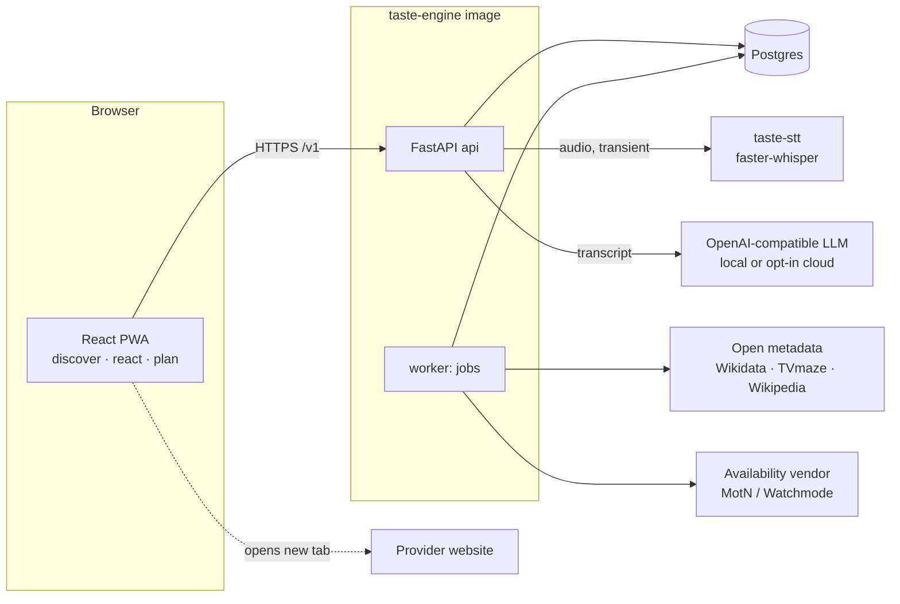

# Architecture: taste-engine

## Overview

A **modular monolith** delivered as two OCI images. The images are host-agnostic and run the
same way on local dev, Coolify and Azure.

| Image | Contents | Roles |
|---|---|---|
| `taste-engine` | Python 3.12, FastAPI and the built React PWA (served as static files from the same origin) | `api` (web + API) and `worker` (jobs), selected by command |
| `taste-stt` *(optional)* | faster-whisper behind a small HTTP API | Speech-to-text |

LLM extraction calls any **OpenAI-compatible endpoint**: Ollama/llama.cpp on the household
server, or Azure OpenAI with consent. Postgres is the system of record on every hosted target.

## Components & interfaces

Python packages under `apps/taste-engine/` (layout proposed; finalized in OPS-01):

| Module | Responsibility | Key interface |
|---|---|---|
| `events` | Append-only evidence store: viewing, feedback, observations, corrections, deletions. Versioned schemas. | `POST /v1/events`, `POST /v1/feedback`, `POST /v1/feedback/{id}/corrections` |
| `importers` | Letterboxd, IMDb, Netflix and Trakt parsers that produce canonical events. Idempotency key = hash(source, row identity). | `POST /v1/imports` (multipart) → job id |
| `catalog` | Open-data catalog: Wikidata (CC0) entities and ID crosswalk (`wd:`, `imdb:`, `letterboxd:`, `netflix:`, `tvmaze:`), TVmaze (CC BY-SA) seasons and episodes, Wikipedia (CC BY-SA) overviews. Per-field license and source, and an attribution footer. No TMDB (decision D1). | Internal `CatalogProvider` protocol |
| `availability` | Vendor adapter (MotN first) giving US offers plus **opaque** launch URLs, the fallback chain, and a link-health log. | `GET /v1/titles/{id}/offers` |
| `genome` | Interpretable attribute scores plus an embedding per title, with source, version and uncertainty recorded. Inputs are limited to licensed fields (D1). | Internal |
| `taste` | Baseline A (popularity/genre), Baseline B (embedding similarity), and Personal v1 (regularized ordinal model). Produces explanations linked to evidence. | `POST /v1/recommendations`, `POST /v1/scores` |
| `voice` | Receives audio, calls STT, then LLM schema-constrained extraction, producing **tentative** observations. Discards audio. | `POST /v1/feedback/voice` |
| `planner` | Monthly service-combination enumeration plus a greedy schedule, or the PenguWatch adapter (D4). | `POST /v1/plans` |
| `profiles` | Export/restore and deletion of viewers and households. | `GET /v1/profiles/{id}/export`, `DELETE /v1/profiles/{id}` |
| `auth` | Pluggable: `passphrase` (household secret + viewer picker) or `oidc` (Authlib; Pocket ID/Authentik/Entra). | Middleware |
| `jobs` | Postgres-backed queue (`procrastinate` or `SKIP LOCKED`) for enrichment, imports and re-ranking. | Worker entrypoint |
| `web` | React + Vite + TS PWA. Covers Discover, Title, Mic/Review, Profile, Subscriptions and Plan. | Consumes `/v1` OpenAPI-generated client |

**Configuration (12-factor env):** `DATABASE_URL`, `AUTH_MODE`, `OIDC_*`, `CATALOG_USER_AGENT` (Wikimedia etiquette),
`AVAILABILITY_PROVIDER`, `AVAILABILITY_API_KEY`, `STT_URL`, `LLM_BASE_URL`, `LLM_MODEL`,
`CLOUD_AI_CONSENT` (default `false`), `PUBLIC_BASE_URL`, `REGION=US`.

### Deployment topology

| Concern | Local dev | Coolify | Azure |
|---|---|---|---|
| Definition | `compose.yaml` | Same `compose.yaml` (Git-backed Compose app) | `infra/azure/*.bicep` + `azure.yaml` (`azd`) |
| Images | Built locally | GHCR tags | Same GHCR tags |
| Web/API | `api` service | `api` with `SERVICE_FQDN_API_8000` | Container App (min replicas 0–1) |
| Worker | `worker` service | `worker` service | Container App (or Job for cron) |
| DB | Postgres container (SQLite allowed for unit tests) | Coolify Postgres resource or compose `postgres` | PostgreSQL Flexible Server B1ms |
| Migrations | `migrate` one-shot | `migrate` with `restart: "no"` | ACA Job run by `azd` hook |
| Secrets | `.env` | Coolify env / `SERVICE_PASSWORD_*` | Key Vault + managed identity |
| TLS | n/a | Traefik / Let's Encrypt | ACA managed certificate |
| STT/LLM | Optional `stt` + host Ollama | Optional `stt` service; LLM on household box | Opt-in Azure AI Speech / Azure OpenAI, or a private self-hosted endpoint |
| Backups | n/a | Coolify scheduled DB backups to S3 | Flexible Server PITR |

The compose file uses `${VAR:-default}` so it also runs under plain `docker compose`. Lines that
only Coolify needs (`SERVICE_FQDN_*`) are harmless to plain Compose.

## Data flow (conceptual)

1. **Import:** the file is uploaded, the importer job parses it into canonical events (idempotent) and the raw file is discarded. Unmatched titles go to a review queue.
2. **Enrich:** the worker fetches metadata for referenced and candidate titles, then computes genome and embeddings and caches them with TTLs.
3. **Rank:** a request is built from the viewer profile and context. Candidates are retrieved and scored with the personal model; explanations come from evidence ids. An optional availability filter is applied last.
4. **Launch:** the user clicks *Watch on X*. The API resolves the offer's opaque URL or falls back, logs a `launch` exposure event, and the browser opens a new tab. No credentials are involved.
5. **React:** text or audio arrives. STT runs (audio is then dropped), then the LLM extracts observations, which are stored as `tentative`. The user can accept, edit or undo; accepting triggers a profile rebuild and a re-rank job.
6. **Plan:** subscriptions, budget, capacity and scores feed the planner, which returns active/next/wait with reasons.

## Tradeoffs

- **Modular monolith vs services:** one image is easiest to run on Coolify and ACA alike. Module boundaries keep later extraction possible. STT is split out only because of its size and CPU needs.
- **Postgres everywhere vs SQLite (dossier default):** SQLite breaks on Azure Files/SMB and on ACA's ephemeral disk. Using one engine avoids dual-dialect bugs. SQLite stays for fast unit tests only.
- **Compose plus Bicep vs one manifest:** `az containerapp compose` is limited and Coolify's magic variables don't map to it. Two thin manifests over the same images is more honest than a lossy translation.
- **In-app OIDC vs platform auth (Easy Auth):** platform auth would leave Coolify without login. Easy Auth can still be layered on Azure.
- **Thin new shell vs adopting Sofa/PenguWatch:** we own the core value (evidence and ranking) and avoid AGPL entanglement. The cost is building basic UI ourselves. PenguWatch could provide the planner via its API.
- **React PWA vs server-rendered HTML:** a PWA is needed for MediaRecorder UX and later phone/TV pairing, and it matches existing repo tooling (Vite/Vitest/Playwright).
- **Web Speech API rejected as default:** it sends audio to vendor clouds. Self-hosted STT is slower to set up but keeps the privacy promise.

## Security & privacy notes

- **No provider credentials ever.** Launch is a plain link opened in a new tab. Our origin never embeds or iframes provider pages.
- **Cloud egress is off by default.** `CLOUD_AI_CONSENT=false` blocks any non-allow-listed STT/LLM host. Consent is per household, logged as an event, and shown in the UI. A test asserts there is no egress with default config (AC-07).
- **Audio:** held in memory or a temp file only. It is deleted after transcription and never written to object storage in the MVP.
- **Deletion:** `DELETE` endpoints hard-delete evidence and derived features. Backups age out per the documented retention (runbook).
- **Auth:** all `/v1` routes are household-scoped. Passphrase mode uses argon2 and rate limiting. OIDC validates issuer and audience. The app trusts `X-Forwarded-*` only from configured proxy ranges.
- **Viewer attribution:** feedback always carries an explicit viewer id selected in the UI and is never inferred silently.
- **Secrets:** Coolify environment / Key Vault, never in images or git. Provider tokens (e.g. Trakt OAuth) are excluded from exports.
- **Third-party terms:** TVmaze and Wikipedia attribution (CC BY-SA) is shown in the UI. Wikidata is CC0. TMDB is not used (D1). Availability-vendor cache TTLs and any vendor-supplied imagery follow that vendor's contract.
- **Exposure:** compose binds only through the proxy. No `0.0.0.0` host-port publishing in the Coolify profile (contrast PenguWatch's default).
